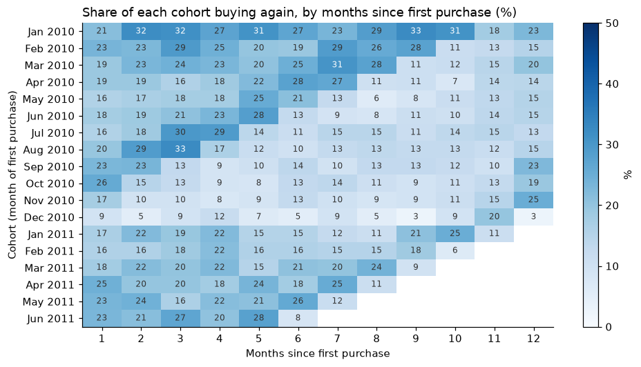

# Retail customer analytics: value, segments and repeat purchase

Sales analysis, cohort retention, customer segmentation and a repeat purchase model on one million real transactions.

**[Open the live dashboard](https://chiamaka-uchenna.github.io/retail-customer-analytics/)** · **[Read the notebook](notebooks/retail_customer_analytics.ipynb)**



## The problem

For most retailers a small share of customers produces most of the revenue, and keeping a customer is cheaper than winning a new one. Knowing who is about to lapse and who is about to buy lets a marketing team spend where it changes the outcome.

## Data

[Online Retail II](https://archive.ics.uci.edu/dataset/502/online+retail+ii) (UCI Machine Learning Repository, CC BY 4.0). Every transaction of a real UK online gift retailer from December 2009 to December 2011: 1,067,371 invoice lines.

The notebook downloads the data itself the first time it runs and caches it in `data/raw/`, so nothing needs to be downloaded by hand.

## Key results

- £19.6 million of revenue across 39,516 orders. Sales peak every autumn: 37% of revenue is earned from September to November.
- Revenue is highly concentrated. The top 20% of customers produce 77% of revenue and the top 1% produce 32%.
- Cohort analysis: in any later month a little under a fifth of a cohort orders again, and 28% of customers order only once in two years.
- K-means on recency, frequency and spend gives four segments. Champions are 20% of customers and 73% of revenue. Customers at risk (once regular, not seen for about six months) hold 17% of revenue and are the natural target for retention.
- Repeat purchase model, validated on a later period: AUROC 0.772 against 0.708 for recency alone. 95% of the customers in the top tenth of scores went on to buy, and the top fifth of the list holds 68% of the following 90 days' revenue.

## Approach

1. An audited cleaning pipeline that records how many rows each rule removes
2. Trend, seasonality, geography and revenue concentration
3. Cohort retention matrix
4. RFM features, log scaling, k-means with silhouette analysis, rule-based naming of segments
5. Out-of-time validation: features from the 365 days before a cutoff, label from the 90 days after, tested on a later cutoff
6. Gains chart for campaign targeting and SHAP explanations

Every step is explained in the notebook, with the reasoning behind each decision.

## Live dashboard

The dashboard is a static page served by GitHub Pages from the `docs/` folder. The trained model is exported from the notebook as JSON and scored in the browser with a few lines of JavaScript, so there is no server to maintain. The notebook checks that the exported model reproduces the original predictions before writing the file.

## Streamlit app

The same model and charts are also packaged as a Streamlit app in `app/`, for hosting on Streamlit Community Cloud or any Python server:

```bash
pip install -r app/requirements.txt
streamlit run app/streamlit_app.py
```

`app/common.py` contains the scoring code: it loads the exported trees and reproduces the model's predictions in plain Python.

## Repository layout

```
notebooks/retail_customer_analytics.ipynb   the full analysis, with outputs
scripts/retail_customer_analytics.py   the same pipeline as a plain Python script
app/                        Streamlit app (streamlit_app.py, common.py, requirements.txt)
docs/                       the static dashboard served by GitHub Pages
data/                       raw data is downloaded here by the notebook (not committed)
requirements.txt            Python dependencies for the notebook
```

## Run it yourself

```bash
git clone https://github.com/Chiamaka-Uchenna/retail-customer-analytics.git
cd retail-customer-analytics
python -m venv .venv
source .venv/bin/activate        # on Windows: .venv\Scripts\activate
pip install -r requirements.txt
jupyter notebook notebooks/retail_customer_analytics.ipynb
```

Running the notebook from top to bottom regenerates every figure and rewrites the files in `docs/data/` that the dashboard reads. To view the dashboard locally:

```bash
python -m http.server 8000 --directory docs
```

## Limitations

One retailer over two years, with many wholesale customers. The test window is the seasonal peak, so predicted probabilities run low although the ranking holds. Predicting who will buy is not the same as knowing whom a campaign will persuade.

## Author

Chiamaka Uchenna

Code is released under the MIT licence. The data belongs to its publishers and is used under the licences noted above.
